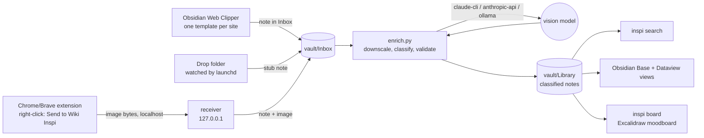

# Wiki Inspi

Capture any image from the web in one gesture into a dedicated [Obsidian](https://obsidian.md) vault, have a vision model classify it in detail (style, palette with hex values, main color, technique, era, mood, subject, composition...), search everything from the terminal or Obsidian, and generate Excalidraw moodboards.

macOS only. Everything runs on your machine; images stay in your vault.

## Install in one line

- **Give this repo URL to Claude Code.** It reads `CLAUDE.md`, installs everything it can, and walks you through the few clicks only you can do.
- **Manual install.** `git clone <this repo> && cd wiki-inspi && ./install.sh`, then follow the printed steps (details below). `inspi doctor` checks every link and prints the fix for what is missing.

### Your 3-minute checklist

1. Open the vault folder in Obsidian, turn on Settings > Community plugins (Excalidraw, Dataview and Note Gallery are fetched by `scripts/install_plugins.py`).
2. `chrome://extensions` (or `brave://extensions`) > Developer mode > Load unpacked > the repo's `extension/` folder.
3. Run `scripts/setup-token.sh`, then within 60 s: the extension's options page > **Pair** > **Test**.
4. Right-click any image > **Send to Wiki Inspi**. A note appears in `Inbox/`, then moves to `Library/` once classified.
5. Optional: Obsidian Web Clipper > Settings > Templates > Import the four files in `~/.config/wiki-inspi/clipper/`.
6. Pick the classifier: Claude login (default), `ANTHROPIC_API_KEY`, or local Ollama (see Configuration).

## Why

Inspiration folders rot: files named `image (3).jpg`, no source, no way to ask "dark blue, risograph, calm". Wiki Inspi makes capture cost one right-click and does the filing for you, so the library stays searchable and sourced (page URL, author when the page states it).

## How it works



Three doors in, one pipeline:

1. **Extension** (`extension/`, Chrome/Brave MV3, loaded unpacked): right-click an image. The extension fetches the bytes itself, in the page with your cookies, and posts them to the local receiver. If the bytes cannot be read it saves the note display-only (remote URL embedded, nothing downloaded).
2. **Obsidian Web Clipper** templates (`clipper/`): generic, Pinterest, Are.na, Wikimedia Commons. The enricher downloads the image later.
3. **Drop folder**: put an image in `~/Inspi Drop`, a launchd watcher files it.

The enricher shrinks each image (1568 px long side, JPEG under 5 MB), asks the model for strict JSON, normalises tags through `_taxonomy.yml`, validates the note with a deterministic validator before it reaches `Library/`, and gives up after 3 failed attempts per note. `author` is never produced by the model: it is copied from the page metadata only (the model may give an `author_guess` with a confidence).

## Install

Requirements: macOS, Python 3.10+, Obsidian, Chrome or Brave. For classification, one of: the [Claude Code](https://claude.com/claude-code) CLI logged in (default), an `ANTHROPIC_API_KEY`, or [Ollama](https://ollama.com) with a vision model.

```sh
git clone <this repo> wiki-inspi && cd wiki-inspi
./install.sh            # asks for the vault folder (default ~/Wiki Inspi)
```

Options: `--vault PATH --port N --backend claude-cli|anthropic-api|ollama --drop-folder PATH --extension-id ID --non-interactive --no-launchd --no-keychain` (the last stores the token in a 0600 file instead of the Keychain, for CI and dry runs). The script is idempotent; it never overwrites your notes, taxonomy or existing config values. It installs missing Python dependencies (Pillow, PyYAML, anthropic) into a private venv, creates the vault skeleton, writes the config, stores a token in the macOS Keychain, installs the `inspi` command in `~/.local/bin` and three launchd agents (`io.github.wiki-inspi.receiver`, `.watcher`, `.enricher`). `./uninstall.sh` removes them (your vault is left alone).

Then, once:

1. `chrome://extensions` > Developer mode > Load unpacked > the repo's `extension/` folder.
2. `scripts/setup-token.sh` (rotates the token and opens a 60 s pairing window), then in the extension's options page click **Pair**, then **Test**. The extension id is not shipped: the first extension that pairs inside the window is remembered in the config and is the only one accepted afterwards. To pin it yourself, run `scripts/setup-token.sh --extension-id <id shown on chrome://extensions>` first.
3. `python3 scripts/install_plugins.py --vault <vault>` downloads the community plugins **Dataview**, **Note Gallery** and **Excalidraw** from their official releases (not bundled in this repo). Open the vault in Obsidian and turn on Community plugins.
4. Optional: in Obsidian Web Clipper, Settings > Templates > Import each file from `~/.config/wiki-inspi/clipper/` (the installer rewrites the vault name in them).

## Configuration

`~/.config/wiki-inspi/config.json` (all keys optional):

| key | default | meaning |
|---|---|---|
| `vault` | `~/Wiki Inspi` | the Obsidian vault (a real path, not a symlink) |
| `port` | `18765` | receiver port on 127.0.0.1 |
| `extension_id` | empty | learned at pairing, or set up front |
| `backend` | `claude-cli` | `claude-cli`, `anthropic-api`, `ollama`, or a comma list used as fallback chain |
| `model` | `claude-haiku-5-5` | model for `claude-cli` and `anthropic-api` |
| `ollama_model` | `gemma3:12b` | local vision model |
| `drop_folder` | `~/Inspi Drop` | watched folder |
| `token_store` | `keychain` | `keychain` or `file` (0600 `token_file`) |
| `log_dir` | `~/Library/Logs/wiki-inspi` | `receiver.log` (refused requests), `enrich.log`, `watcher.log` |

`anthropic-api` reads `ANTHROPIC_API_KEY` from the environment; for the launchd agents add it to the `EnvironmentVariables` of the installed plists. The `claude-cli` backend runs the CLI with only the Read tool, in the image's temp directory, with the API key stripped from its environment. Vocabulary (the closed `use_for` list and tag synonyms) lives in `<vault>/_taxonomy.yml`: replace the example list with your own.

## Usage

```sh
inspi search "dark blue"                       # free text over title, tags, style, mood, subject
inspi search --color "#1e3a8a" --style minimalism --mood calm --limit 10
inspi search "ferrofluid" --json
inspi board "ferrofluid" --name ferrofluid     # writes Moodboards/ferrofluid.excalidraw.md
inspi open                                     # open the hub note in Obsidian
inspi doctor                                   # check every link, print the fix for what is missing
```

`--color` takes a hex or a name and ranks by perceptual distance to each note's palette. Other filters: `--technique --author --domain --use-for`. Reclassify old notes with `~/.local/share/wiki-inspi/venv/bin/python src/enrich.py --reenrich-all`; check one note with `--validate NOTE.md`.

## Privacy and security

- Images, notes and the index live in your vault. Nothing is uploaded except the classifier call: with `claude-cli` or `anthropic-api` the downscaled image and the page text (title, URL, alt) go to Anthropic; with `ollama` nothing leaves the machine.
- The receiver listens on 127.0.0.1 only. Any web page can make your browser send requests there, so every request must pass, in order: `Host == 127.0.0.1:<port>` (DNS rebinding), `Origin == chrome-extension://<paired id>` (web pages and other extensions), and a bearer token compared in constant time against the Keychain value on each request. No CORS headers are sent. Image bytes are verified by magic bytes and Pillow, names are server-made, writes are confined to the vault. The one URL the receiver fetches itself is a Pinterest pin page (https, Pinterest host, `pinimg.com` images only).
- The token is generated in-process and stored in the Keychain (service `wiki-inspi-token`, account = your user). Pairing hands it to the extension once, inside a 60 s window; the extension keeps it in `chrome.storage.local` (readable from your browser profile: it is a dedicated token, rotate it with `scripts/setup-token.sh`). The value is handed to `security add-generic-password -w` through its password prompt (a pseudo-terminal), never as a command-line argument.

## Limitations

- macOS only (Keychain, launchd, `sips`/Pillow).
- The extension is loaded in developer mode; it is not on the Chrome Web Store.
- Pinterest: the original-size image is fetched through Pinterest's own pages, which is fragile and subject to their terms. Use it for personal reference only and respect authors' copyright. Same for anything you capture: the tool stores a source URL and, when the page says so, an author, but rights stay with the creator.
- Classification quality depends on the model; the validator rejects malformed output, not wrong opinions.
- Obsidian plugins are not bundled; the Base and Dataview views need them.

## Development

```sh
python3 -m venv .venv && . .venv/bin/activate && pip install -r requirements.txt -r requirements-dev.txt
python3 -m pytest -q tests --ignore=tests/e2e
```

`tests/e2e/` drives real Chromium with the unpacked extension in a fresh temporary profile (never your real one); it needs Playwright and is optional.

## En bref (FR)

Un clic droit sur une image web l'envoie dans un vault Obsidian dédié; un modèle de vision la classe (style, palette, couleur principale, technique, époque, ambiance); `inspi search` et `inspi board` cherchent et fabriquent des moodboards Excalidraw. Tout reste en local, sauf l'appel au classifieur si vous choisissez un modèle cloud. Installation : `./install.sh`, puis chargez `extension/` en mode développeur et appairez avec `scripts/setup-token.sh`.

## License

MIT, see `LICENSE`.
